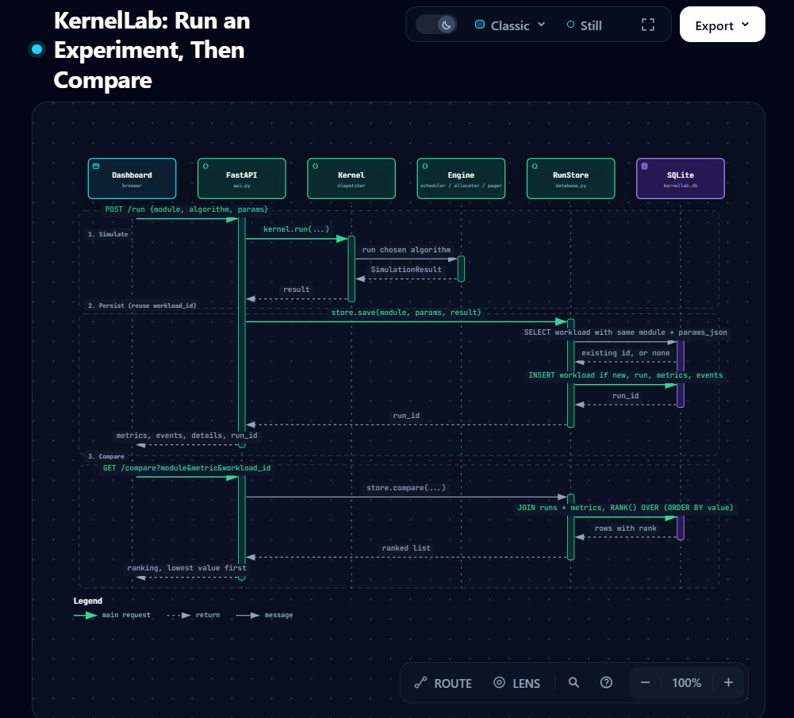

# KernelLab

KernelLab is a pure-Python operating-systems simulator with a FastAPI dashboard. It runs reproducible CPU scheduling, memory, virtual-memory, deadlock, and synchronization experiments; stores every run in SQLite; and ranks algorithms on the same workload.

It is a portfolio-ready systems project with a non-root Docker image, persisted experiment history, raw SQL analytics, a Windows host-process capture workflow, automated tests, and GitHub Actions CI.

<p align="center">
  
</p>

<p align="center"><em>One experiment: the dashboard posts a workload, the kernel dispatches it to an algorithm engine, and the result is saved in SQLite for comparison.</em></p>

## Features

- **OS algorithms:** CPU scheduling, contiguous and buddy allocation, page replacement, deadlock detection and avoidance, and synchronization.
- **Backend:** FastAPI routes, SQLite persistence, workload-aware comparison, SQL aggregation, and window-function ranks.
- **Dashboard:** select a module and algorithm, edit workload JSON, run experiments, and inspect stored history.
- **Deployment:** Docker Compose with a persistent named volume and a non-root application user.
- **Host workload capture:** PowerShell script captures real Windows process data and derives simulation inputs.

## Quick start

### Docker (recommended)

```powershell
docker compose up --build
```

Open [http://localhost:8000](http://localhost:8000). Docker keeps the SQLite database in a named volume, so runs survive restarts.

### Local development

Requires Python 3.11+.

```powershell
python -m venv .venv
.\.venv\Scripts\Activate.ps1
pip install -r requirements.txt
uvicorn kernellab.api:app --reload
```

## Algorithms and metrics

| Module | Algorithms | Recorded metrics |
|---|---|---|
| CPU scheduling | FCFS, SJF, SRTF, Round Robin, Priority | average waiting, turnaround, response, makespan, throughput |
| Memory allocation | First Fit, Best Fit, Worst Fit, Buddy | utilization, failure rate, internal and external fragmentation |
| Virtual memory | FIFO, LRU, Clock, Optimal | page faults, hit ratio |
| Deadlock | Wait-for graph DFS, Banker's algorithm | detected cycle, safe sequence |
| Synchronization | producer-consumer, ordered dining philosophers, protected thread counter | blocked operations, deadlocks, lost updates |

## Architecture

```text
Browser dashboard
       |
FastAPI: /run, /history, /compare, /stats, /snapshots
       |
Kernel dispatcher --> CPU / memory / VM / deadlock / synchronization
       |                              |
       +-------- SimulationResult <---+---- events and metrics
       |
SQLite: workloads, runs, metrics, events, snapshots
```

`SimulationResult` carries the module, algorithm, metrics, event trace, and module-specific details. `RunStore` persists the result as a workload plus associated runs, metrics, and events. Identical JSON workloads reuse a `workload_id`, making comparisons fair.

## API

Interactive API documentation: [http://localhost:8000/docs](http://localhost:8000/docs)

| Route | Purpose |
|---|---|
| `POST /run` | Execute an algorithm and persist workload, metrics, and events |
| `GET /history` | List runs; supports `module`, `algorithm`, and `limit` filters |
| `GET /compare` | Rank algorithms by `module`, `metric`, and optional `workload_id` |
| `GET /stats` | Aggregate recorded metrics by module and algorithm |
| `POST /snapshots/import` | Store a Windows host snapshot produced by the provided script |
| `POST /snapshots/{psutil|fake}` | Capture a portable probe snapshot from the app environment |

### Run a sample workload

```powershell
$body = Get-Content .\examples\cpu_round_robin.json -Raw
Invoke-RestMethod -Uri "http://localhost:8000/run" -Method Post `
  -ContentType "application/json" -Body $body
```

Ready-to-send request bodies are in [`examples/`](examples). Run several algorithms using the same request body, look up their common workload ID with `/history`, then compare them:

```text
http://localhost:8000/compare?module=cpu&metric=avg_waiting_time&workload_id=21
http://localhost:8000/compare?module=memory&metric=external_fragmentation&workload_id=20
```

For CPU time and memory fragmentation/failure metrics, lower rank is better. `rank = 1` may be shared when values tie.

## Database and SQL

```text
workloads (id, seed, kind, params_json, created_at)
    1 ---- * runs (id, workload_id, module, algorithm, created_at)
                 1 ---- * metrics (metric_name, value)
                 1 ---- * events (tick, event_type, payload_json)

snapshots (id, taken_at, source, process_json)
```

Indexes exist on `(workload_id, module)` and `(run_id, metric_name)`. Reusable joins, aggregation, and window-function examples are in [`sql/analytics.sql`](sql/analytics.sql).

```sql
EXPLAIN QUERY PLAN
SELECT * FROM runs WHERE workload_id = 1 AND module = 'cpu';
```

## Real Windows host experiment

Containers can see only their own processes. Capture real Windows processes from a second PowerShell window on the host:

```powershell
$project = "C:\path\to\KernelLab"
Set-Location $project
powershell -NoProfile -ExecutionPolicy Bypass -File .\scripts\capture_windows_snapshot.ps1 -OutputDirectory .\work

$snapshot = Get-Content .\work\windows-snapshot.json -Raw
Invoke-RestMethod -Uri "http://localhost:8000/snapshots/import" -Method Post `
  -ContentType "application/json" -Body $snapshot
```

The script writes ignored local files:

- `work/windows-snapshot.json`: raw PID, process name, CPU time, and RSS data.
- `work/windows-derived-workloads.json`: normalized CPU and memory workloads.

On a captured 449-process Windows workload and a deliberately fragmented simulated heap, Best Fit reduced external fragmentation from 79.4% to 58.8% versus First Fit. On the host-derived CPU workload, SJF and SRTF reduced average waiting time 69.1% versus FCFS.

The host process data is real. Memory-hole layout and CPU burst duration are explicit simulation normalizations, not claims about Windows kernel scheduling or physical allocation.

## Tests

```powershell
# Local
pytest -q

# Inside the running container
docker compose exec app pytest -q
```

The test suite covers hand-computed scheduling metrics, FIFO Belady's anomaly, Banker's safety, wait-for cycles, allocation placement and failures, synchronization safety, SQLite comparison/ranking, and API integration.

## Repository layout

```text
kernellab/               application package and dashboard assets
  api.py                 FastAPI routes
  kernel.py              module dispatcher
  scheduling.py          CPU algorithms
  memory.py              allocation and page replacement
  deadlock.py            graph and Banker algorithms
  synchronization.py     synchronization simulations
  database.py            SQLite schema and query layer
scripts/                 Windows host capture
examples/                ready-to-send API request bodies
sql/                     raw analytics queries
tests/                   unit and integration tests
Dockerfile               non-root Python 3.11 image
docker-compose.yml       app plus persistent SQLite volume
```

## GitHub workflow

The GitHub Actions workflow at [`.github/workflows/tests.yml`](.github/workflows/tests.yml) runs `pytest -q` on pushes and pull requests targeting `main`.

## Scope

KernelLab deliberately excludes file systems, disk scheduling, IPC, machine learning, and real kernel scheduling. It is an educational simulator: metrics are deterministic for an input workload and make algorithm trade-offs observable.

## License

Released under the [MIT License](LICENSE).
